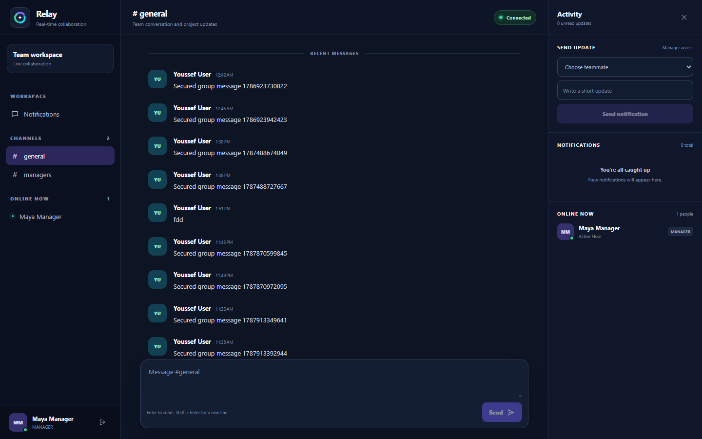
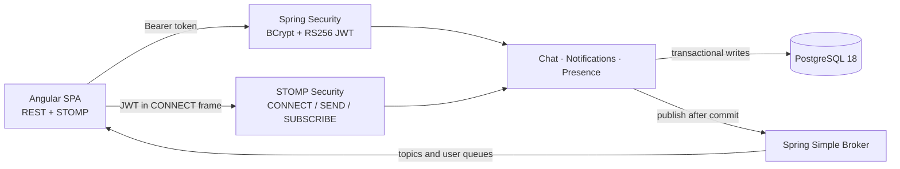
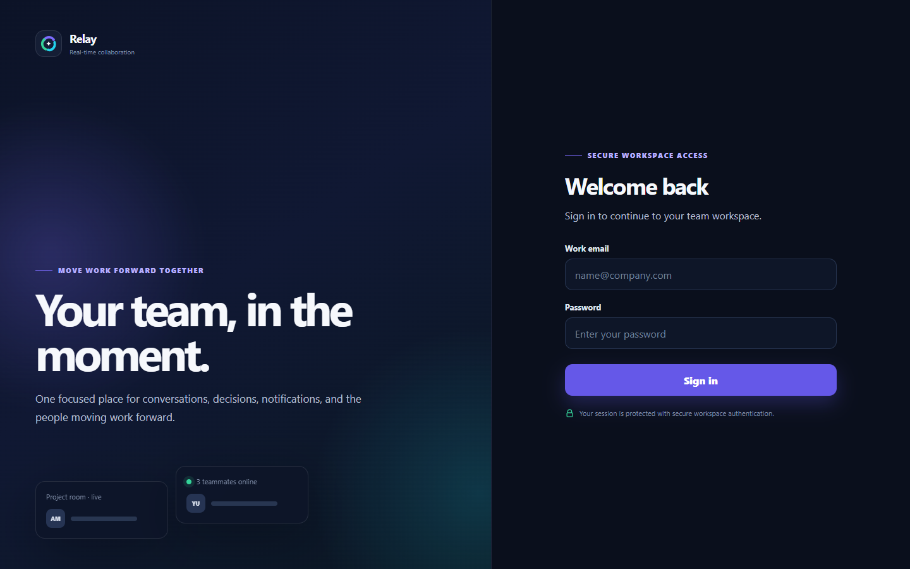
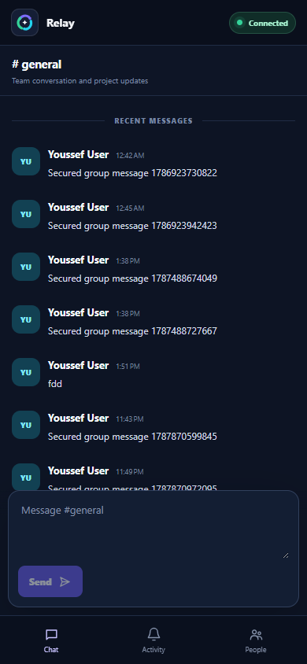
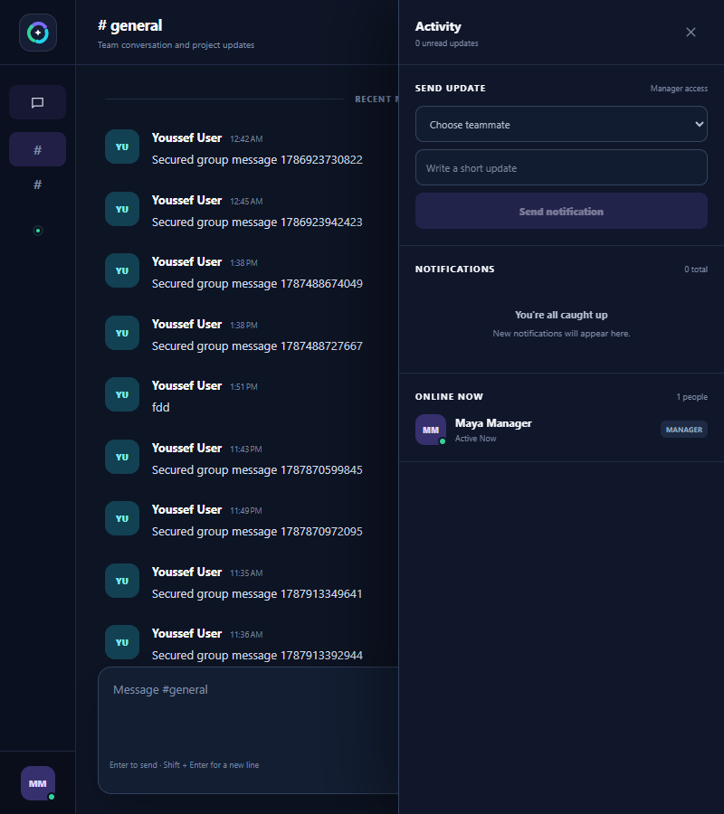
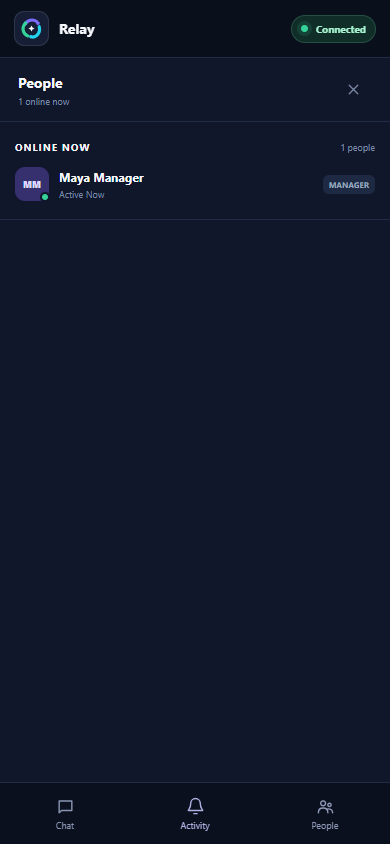

# Relay: Real-Time Collaboration Platform

Relay is a full-stack collaboration workspace built with Angular, Spring Boot, STOMP over WebSocket, and PostgreSQL. It combines persistent channel chat, durable notifications, unread state, role-aware access, and multi-session presence in a responsive interface.



## Highlights

- JWT-secured REST and STOMP connections with RS256, issuer, audience, and role validation.
- Persistent channel chat with cursor pagination, read cursors, and idempotent client message IDs.
- Durable per-user notifications delivered live and recovered after reconnect.
- Multi-session presence that emits online and offline changes only on first connect and final disconnect.
- Bounded reconnect with jitter, automatic re-subscription, and ID-based state reconciliation.
- Deny-by-default STOMP authorization, frame limits, origin checks, and per-user send-rate limiting.
- Responsive desktop, tablet, and mobile layouts for chat, activity, and people views.
- Integration, unit, security, and browser regression coverage.

## Architecture



REST provides durable snapshots and recovery. STOMP carries live chat, notification, presence, and command-error events. The same JWT decoder and authority mapping protect both transports.

See [Architecture](docs/architecture.md) for consistency guarantees and module boundaries, and [Scalability](docs/scalability.md) for the multi-node roadmap.

## Technology

| Layer | Stack |
| --- | --- |
| Frontend | Angular 22, TypeScript 6, RxJS, STOMP.js |
| Backend | Java 25, Spring Boot 4.1, Spring Security, Spring WebSocket |
| Data | PostgreSQL 18, Spring Data JPA, Flyway |
| Security | BCrypt, OAuth2 Resource Server, JOSE, RS256 JWT |
| Testing | JUnit 5, Testcontainers, Vitest, Playwright |
| Local infrastructure | Docker Compose, Maven Wrapper, npm |

## Quick Start

### Prerequisites

- Java 25 JDK
- Node.js 24 LTS and npm
- Docker Desktop
- Google Chrome for the Playwright suite

From PowerShell in the repository root:

```powershell
.\scripts\start-app.ps1
```

The launcher starts PostgreSQL, the Spring API, and the Angular client, then waits for readiness. Open <http://localhost:4201>.

Development-only accounts are seeded when the `development` Spring profile is active:

| Role | Email | Password |
| --- | --- | --- |
| ADMIN | `admin@collaboration.local` | `Admin123!` |
| MANAGER | `manager@collaboration.local` | `Manager123!` |
| USER | `user@collaboration.local` | `User123!` |

Stop the local stack with:

```powershell
.\scripts\stop-app.ps1
```

The default ports are frontend `4201`, API `8081`, and PostgreSQL `5434`.

## Verification

Run backend tests, frontend tests, and the production frontend build:

```powershell
.\scripts\verify.ps1
```

Run the complete browser suite while the application is running:

```powershell
.\scripts\verify.ps1 -IncludeE2E
```

The browser tests use isolated contexts to exercise role-based collaboration, offline notification recovery, multi-tab presence, and responsive navigation.

## Configuration

`.env.example` documents the supported environment variables. Production startup requires a matching RSA public/private key pair and disables demo accounts by default.

| Variable | Purpose |
| --- | --- |
| `DB_URL`, `DB_USERNAME`, `DB_PASSWORD` | PostgreSQL connection |
| `SERVER_PORT` | Spring API port |
| `CORS_ALLOWED_ORIGIN` | Allowed browser and WebSocket origin |
| `JWT_ISSUER`, `JWT_AUDIENCE` | Token validation contract |
| `JWT_PUBLIC_KEY`, `JWT_PRIVATE_KEY` | PEM-encoded RS256 key pair |
| `JWT_REQUIRE_CONFIGURED_KEYS` | Reject startup without configured keys |
| `DEMO_DATA_ENABLED` | Enable development-only users and channels |

Access tokens are held in `sessionStorage` and sent in REST authorization headers and the STOMP `CONNECT` frame. Tokens are never placed in the WebSocket URL.

## Repository Structure

```text
backend/             Spring Boot API, WebSocket security, domain modules, migrations, tests
frontend/            Angular SPA, feature stores, responsive interface, unit tests
e2e/                 Playwright collaboration and responsive journeys
docs/                Architecture, scalability, screenshots, and engineering notes
scripts/             Reproducible Windows startup, shutdown, and verification commands
compose.yaml         Local PostgreSQL service
.env.example         Non-secret configuration template
```

## Screenshots

| Sign in | Mobile chat |
| --- | --- |
|  |  |

| Tablet activity | Mobile people |
| --- | --- |
|  |  |

## Production Considerations

The current runtime targets one Spring Boot instance and uses Spring's in-memory broker. A production multi-node deployment should add TLS, managed key rotation, a broker relay, shared presence state, a transactional outbox, centralized observability, and load testing. The [scalability roadmap](docs/scalability.md) describes that progression.

## Engineering Notes

[Engineering notes](docs/engineering-notes.md) document two important failure modes and their regression coverage: retaining the authenticated STOMP principal across frames, and reconciling stale presence snapshots with newer live events.
