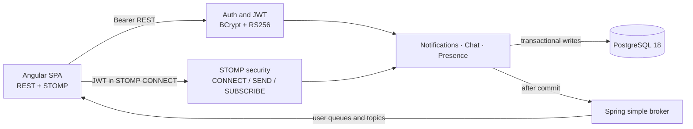

# Architecture

The platform is a single-node modular monolith with an Angular client and PostgreSQL. REST carries durable snapshots and commands that do not require a live channel. STOMP over WebSocket carries live chat, notifications, presence, and safe command errors.

## Security and identity

`POST /api/auth/login` is the only public application operation. It returns a 30-minute RS256 JWT containing a numeric user ID in `sub`, one scalar role, issuer, audience, email, and display name. REST and STOMP use the same decoder and authority converter. The browser sends the token in the STOMP `CONNECT` frame—not the WebSocket URL—so it does not enter URL history or ordinary access logs.

The inbound channel interceptor authenticates `CONNECT`, retains the resulting principal on the WebSocket session, and denies unknown destinations. Clients may send only to `/app/chat.send`. Subscriptions are restricted to the caller's user queues, presence, exact role, and accessible chat channels. Message sender identity always comes from the principal.

## Delivery and consistency

Notifications and chat are written in database transactions. Publication is registered after commit and runs on a bounded, single-worker executor. This prevents an event for a rolled-back record and preserves publication order within this process. A saturated publisher rejects visibly; durable REST recovery is the fallback.

Delivery is at least once from the browser's perspective. Notification and chat IDs make state reconciliation idempotent. Chat commands also contain a client message ID with a database uniqueness constraint, so a retried send does not create another row.

Presence is deliberately ephemeral. It counts WebSocket sessions per user, emits online only for the first session, and emits offline only after the final session closes. On connect or reconnect the client subscribes before requesting a snapshot, buffers any live deltas received while that snapshot is in flight, and replays them over the snapshot so older REST state cannot overwrite newer WebSocket events.

## Boundaries

- `auth` and `user` own credentials, JWTs, and the local identity model.
- `realtime` owns transport configuration, authentication/authorization, envelopes, and publication.
- `notification` owns durable per-user notifications and unread state.
- `chat` owns channels, messages, idempotency, history, and read cursors.
- `presence` owns in-process session counts and snapshots.
- Angular has one root WebSocket service and small feature stores that merge REST snapshots with live events.

The application owns its authentication model, database schema, session-storage namespace, issuer, audience, and RSA key material. It has no runtime dependency on another repository or identity provider.
